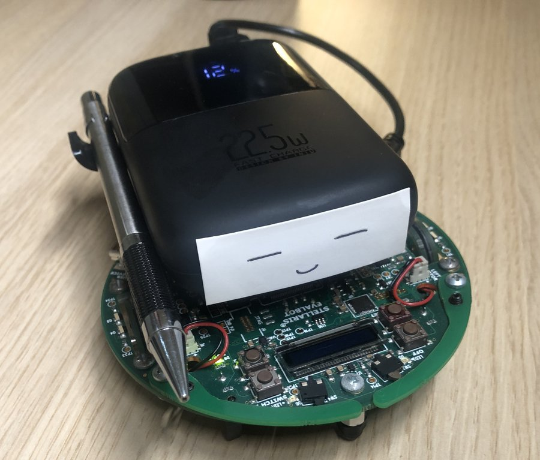
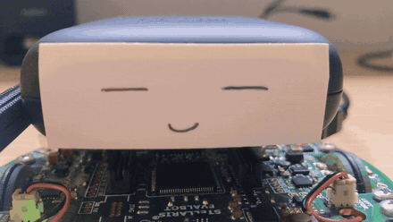
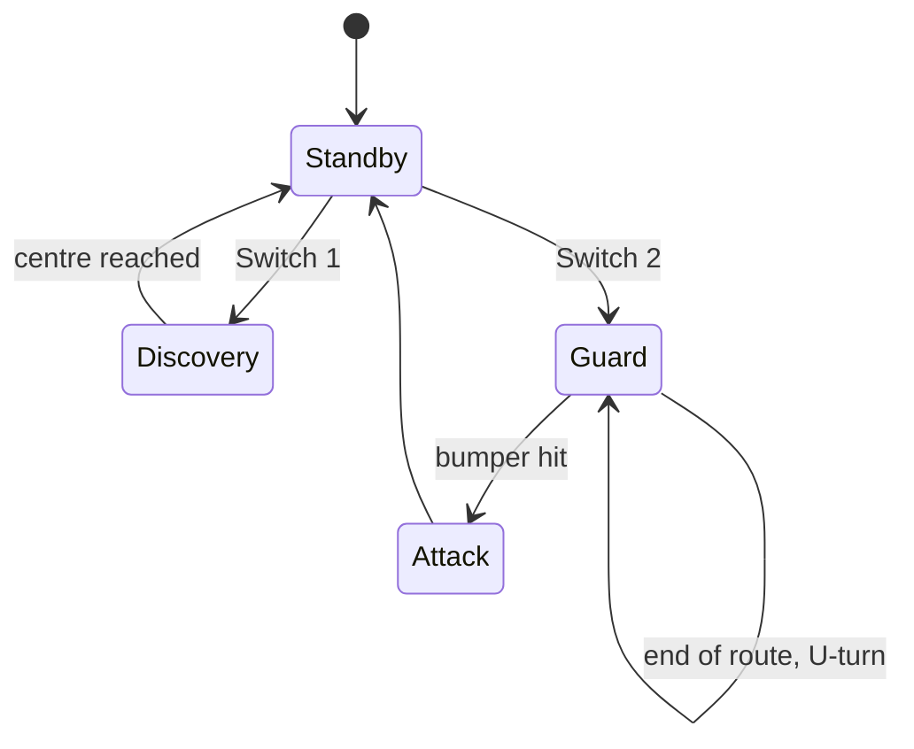

<p align="center">
  
</p>

# Quirinus

**An autonomous guard robot written entirely in ARM Cortex-M3 assembly, running bare-metal on a Texas Instruments Stellaris EvalBot.**

Quirinus measures the room it is placed in, positions itself in the middle, then patrols that area and attacks any intruder it bumps into with a pen fixed to its side. There is no C, no RTOS and no driver library: every peripheral (PWM, GPIO, cycle counter) is configured directly at register level from the microcontroller datasheet.


-informational)


<p align="center">
  <br>
  <em>Meet Quirinus.</em>
</p>

## Context

Open-ended project for an embedded systems course at ESIEE Paris: the only requirement was to build something with the EvalBot. The concept, the robot's behaviour and logic, the hardware add-ons and the logo were all my own choices, from the first idea to the final demo.

## Features

- **Discovery mode**: the robot drives to a wall, turns around, crosses the area to the opposite wall while timing the run with the hardware cycle counter, stores the measured length in RAM, then comes back to the centre.
- **Guard mode**: using the stored length, the robot patrols back and forth around its starting point, making a U-turn at each end of its route.
- **Intruder attack**: if a bumper is hit during the patrol, the robot moves back and forth three times to stab the intruder with its pen, then flashes its LEDs and returns to standby.
- **User feedback**: LED blink codes and short motor "animations" confirm each mode change, so the robot can be operated without a screen.

## How it works

<p align="center">
  
</p>



**Standby.** Motors and LEDs are off and the program polls the two push buttons.

**Discovery.** After a 90° turn, the robot moves forward until a bumper is triggered, backs up and makes a 180° turn. At that point it reads the `DWT_CYCCNT` register, drives to the opposite wall and reads the counter again. The difference gives a value proportional to the width of the area, which is saved in SRAM. The robot then turns around and drives for half of that time to stop in the middle.

**Guard.** The robot reuses the measured length to compute the size of its patrol route, so it adapts to the room without any hardcoded distance. Bumpers are checked continuously while it moves.

**Attack.** When a bumper is pressed, the robot alternates short backward and forward moves so the pen pecks at whatever it has hit, then signals the detection with a fast LED blink sequence.

**Calibration.** Without wheel encoders, every movement is time-based. The turn durations (45°, 90° and 180°) and travel distances were calibrated by tracing the robot's moves on graph paper, then stored as constants (`ROT_TIME_45`, `ROT_TIME_90`...) in `main.s`.

## Hardware

| Component | Details |
| --- | --- |
| Board | Texas Instruments Stellaris EvalBot |
| MCU | LM3S9B92, ARM Cortex-M3 |
| Motors | 2 DC motors driven by DRV8801 H-bridges through hardware PWM |
| Sensors | 2 front bumpers |
| Interface | 2 push buttons, 2 LEDs |
| Add-on | Pen fixed along the side of the power bank, tip sticking out past the front bumpers |
| Power | External power bank mounted on the robot, so it runs untethered with no cable or disposable batteries |

Pin mapping used by the drivers:

| Function | Pins |
| --- | --- |
| Right motor (PWM / direction) | PD0 / PD1 |
| Left motor (PWM / direction) | PH0 / PH1 |
| H-bridge slow decay, 12 V enable | PD2, PD5 |
| LEDs | PF4, PF5 |
| Bumpers | PE0, PE1 (internal pull-ups) |
| Push buttons | PD6, PD7 (internal pull-ups) |

## Project structure

```
Programs/
├── main.s            # State machine: standby, discovery, guard and attack modes
├── motor_config.s    # PWM generators + GPIO setup, motor on/off and direction
├── led_config.s      # Port F setup and LED control
├── bumper_config.s   # Port E setup and bumper reading
└── switch_config.s   # Port D setup and push button reading
RTE/                  # CMSIS startup and system files for the Cortex-M3
Quirinus.uvprojx      # Keil µVision project
docs/                 # Banner, photo and demo GIF used in this README
```

Each peripheral lives in its own module and exposes a small API (`MOTEUR_DROIT_AVANT`, `LED_GAUCHE_ON`, `BUMPER_DROIT`...) imported by `main.s`, which keeps the main program readable despite being written in assembly.

## Technical highlights

- Register-level configuration of clocks and GPIO (direction, digital enable, pull-ups) for the LED, bumper and switch modules, based on the LM3S9B92 datasheet.
- Use of bit-banded GPIO data addresses to read a single pin in one load instruction.
- Distance measurement with the ARM CoreSight DWT cycle counter, enabled through the `DEMCR` register.
- Subroutines with proper link register handling (`PUSH {LR}` / `POP {PC}`) for nested calls.

## Build and run

1. Install **Keil MDK-ARM** (µVision 5) with the ARM Cortex-M3 device pack.
2. Clone the repository and open `Quirinus.uvprojx`.
3. Build the project (`F7`).
4. Connect the EvalBot over USB and download the program (`F8`).
5. Place the robot in the area to guard, press **Switch 1** to run the discovery, then **Switch 2** to start guarding.

## Limitations and possible improvements

- Movements are open-loop: turns and distances rely on calibrated delay loops, so accuracy depends on wheel slip and floor surface. Wheel encoders would allow closed-loop control.
- Inputs are polled; moving bumpers and buttons to GPIO interrupts would free the CPU and make reactions faster.
- The measured length is kept in RAM and lost on reset; it could be stored in flash.

## Acknowledgements

Thanks to ESIEE Paris for providing the EvalBot hardware that made this project possible.
